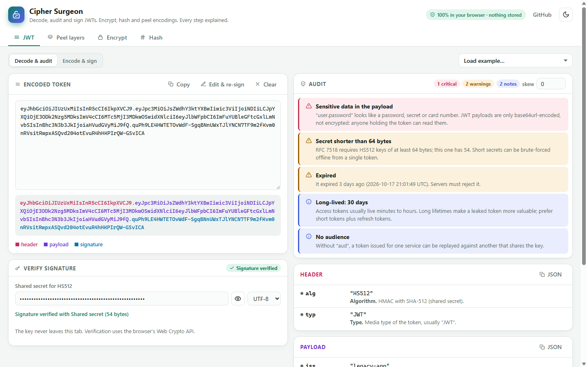

# Cipher Surgeon

**Paste a JWT and see every claim explained, every security problem flagged, and whether the signature holds. Encrypt and decrypt text with a password, hash files, and peel nested encodings layer by layer. It all runs in your browser.**

**Live demo:** https://uvilleramente.github.io/cipher-surgeon/ · **npm:** `npm install cipher-surgeon` · sibling of [JSON Surgeon](https://github.com/UvilleraMente/json-surgeon)



## Features

### JWT: decode, audit, verify, sign

- **Explains every claim.** `exp`, `iat`, `nbf` become dates with “in 12 minutes” / “3 days ago”. Each registered claim (RFC 7519, OpenID Connect, Microsoft Entra, OAuth) gets a plain-English description and its source.
- **Audits the token without any key.** Findings are sorted by severity:
  - **critical:** `alg: none`, an empty signature, a signature made with a **well-known weak secret** (it tries a short list such as `your-256-bit-secret`), passwords, API keys or Luhn-valid card numbers in the payload
  - **warning:** expired, not yet valid, issued in the future, never expires, dates written as strings or **milliseconds** instead of seconds, embedded `jwk` (CVE-2018-0114), `jku` / `x5u` key URLs, `kid` path traversal or SQL injection, an HMAC secret shorter than RFC 7518 requires
  - **info:** long lifetimes, missing `iss` / `aud`, `crit` headers, unusual `typ`
- **Verifies signatures** for HS256/384/512, RS256/384/512, PS256/384/512, ES256/384/512 and EdDSA. Paste a shared secret (UTF-8, base64 or hex), a PEM public key, an **X.509 certificate**, a JWK, or a whole **JWKS** (it picks the key by `kid`). Legacy `RSA PUBLIC KEY` blocks get the exact `openssl` command to convert them.
- **Signs and edits tokens.** Edit the header and payload, add `iat`/`exp`/`jti` with one click, sign with a secret, a PKCS#8 private key or a private JWK, and send the result straight back to the auditor.
- **Forgiving input.** Strips `Authorization: Bearer`, line breaks from logs, and explains mistakes like padded base64 or `+`/`/` characters.

### Peel layers

Paste anything encoded (a cookie, a query string, a log line) and it removes one layer at a time, saying what each layer was:
URL encoding → base64 / base64url → hex → gzip / zlib → HTML entities → `\uXXXX` escapes → quoted JSON strings, until it reaches **JSON, a JWT, a PEM block, a UUID (with the v7 timestamp), a Unix timestamp, or binary data identified by its magic bytes** (PNG, PDF, ZIP…).

It also tells you what *can’t* be decrypted: a 64-hex-digit string is identified as a probable SHA-256 digest, and `$2b$…` as a bcrypt hash.

### Encrypt / decrypt

- **AES-256-GCM** with a key from **PBKDF2-SHA-256, 600,000 iterations** (OWASP 2023), a random 16-byte salt and 12-byte IV.
- The output is one copy-pasteable string, `cs1.<iterations>.<salt>.<iv>.<ciphertext>`. The header is **authenticated** as GCM additional data, so changing the iteration count or salt makes decryption fail instead of silently deriving another key.
- Clear errors: wrong password or tampering, malformed envelopes, out-of-range iteration counts (capped so a crafted envelope can’t freeze the tab).
- Password strength meter and a 128-bit random password generator.

### Hash

SHA-1, SHA-256, SHA-384 and SHA-512 of text or **files** (read locally), as hex, base64 or base64url, with optional **HMAC** and a field to compare against an expected checksum.

### Privacy

Everything uses the browser’s **Web Crypto API**. Nothing is uploaded, and **tokens, keys, passwords and text are never written to storage**: only the selected tab, the theme and the output encoding are remembered. There are no share links on purpose, because a URL is a bad place for a secret.

## Use it as a library

```bash
npm install cipher-surgeon
```

Zero dependencies. ESM, CommonJS and TypeScript types. It uses the global `crypto`, so it runs in Node 20+, Deno, Bun, workers and browsers.

```ts
import { inspectJwt, verifyJwt, signJwt, encryptText, decryptText, peel } from 'cipher-surgeon';

// Decode + explain + audit in one call (also tries well-known weak HMAC secrets).
const report = await inspectJwt(token);
for (const f of report.findings) console.log(`${f.severity}: ${f.title} — ${f.detail}`);
// critical: Signed with a well-known secret — The HMAC secret is “your-256-bit-secret”…
// warning: Never expires — There is no “exp” claim…

// Verify with a secret, PEM, certificate, JWK or JWKS.
const result = await verifyJwt(token, publicKeyPem); // { status: 'valid' | 'invalid' | 'error', message, … }

// Sign
const jwt = await signJwt({ alg: 'ES256', kid: 'k1' }, { sub: '42', exp: now + 900 }, privateKeyPem);

// Password-based encryption
const envelope = await encryptText('meet at 6', 'correct horse battery staple');
const opened = await decryptText(envelope, 'correct horse battery staple'); // { ok: true, plaintext }

// Peel nested encodings
const { layers, result: final } = await peel('eyJhIjoxfQ%3D%3D');
// layers: URL encoding → Base64 · final: JSON
```

Lower-level pieces are exported too: `decodeJwt`, `auditJwt`, `explainPayload`, `explainHeader`, `findWeakSecret`, `importKey`, `hash`, `hashAll`, and the base64/hex/UTF-8 helpers.

## CLI

```bash
npx cipher-surgeon jwt eyJhbGciOi...                       # decode, explain and audit
npx cipher-surgeon verify token.txt --key public.pem      # exit 0 valid, 1 invalid, 2 error
echo '{"sub":"42"}' | npx cipher-surgeon sign - --alg HS256 --secret "$SECRET" --expires-in 15m
CIPHER_SURGEON_PASSWORD=… npx cipher-surgeon encrypt notes.txt > notes.cs1
CIPHER_SURGEON_PASSWORD=… npx cipher-surgeon decrypt notes.cs1
npx cipher-surgeon hash big.iso --alg all
npx cipher-surgeon peel cookie.txt                        # layers on stderr, result on stdout
npx cipher-surgeon jwt "$TOKEN" --check                   # exit 1 on critical findings (CI)
```

Passwords and secrets can come from `CIPHER_SURGEON_PASSWORD` / `CIPHER_SURGEON_SECRET`, so they stay out of your shell history.

## Why I built this

Debugging auth means pasting tokens somewhere. Most JWT tools show you the JSON and stop. The questions I actually have are different: *Is it expired, and by how much? Why does the API reject it? Would this token be accepted if someone changed it?* Answering them means reading RFCs and knowing the classic attacks: `alg: none`, embedded keys, `kid` injection, tutorial secrets in production.

Cipher Surgeon answers them next to the token, in plain language, the same way [JSON Surgeon](https://github.com/UvilleraMente/json-surgeon) explains every JSON fix. The other tools (encrypt, hash, peel) are the jobs that kept coming up around tokens: decoding a cookie, checking a checksum, sending a secret to a colleague without a third-party site.

## How it works

- **No crypto of its own.** All primitives come from Web Crypto (`subtle.verify`, `sign`, `deriveKey`, `encrypt`, `digest`), so the code only does parsing, explaining and key import. Signature comparisons for the weak-secret check use constant-time byte comparison.
- **Key import** (`src/core/jwt/keys.ts`) accepts what people actually paste: it detects PEM labels, pulls the public key out of an X.509 certificate with a small DER walker, strips private members from a JWK before verifying, and picks keys from a JWKS by `kid`.
- **The audit** (`src/core/jwt/audit.ts`) is a pure function of the decoded token and the current time, so every rule is unit-tested with a fixed clock.
- **Peel** (`src/core/inspect/peel.ts`) runs detectors in a fixed order, from most specific (JWT, envelope, JSON, PEM, password hashes, UUIDs) to most generic (URL, entities, hex, base64). A base64 layer is only accepted if it decodes to text, to known magic bytes, or looks strongly like base64, so ordinary words are left alone.
- The framework-free core in `src/core` is shared by the web app, the CLI and the npm package.

## Tech stack

- **Angular 20**: standalone components, signals, `@if`/`@for`, OnPush, zoneless change detection
- **TypeScript** (strict) for a framework-free core in `src/core`
- **Web Crypto API**, `CompressionStream` / `DecompressionStream`
- **Vitest**: tests with RFC 4648, NIST and RFC 4231 vectors, the jwt.io token, generated RSA/EC key pairs, tamper tests, the CLI and the library entry
- Hand-written **SCSS** with CSS custom properties, light and dark themes. No UI library, icon font or web font.
- **esbuild** for the CLI and the library, **GitHub Actions** for CI and **GitHub Pages** for deployment

## Run locally

Requires Node.js 20 or newer.

```bash
npm install
npm start            # http://localhost:4200
npm test             # Vitest
npm run typecheck
npm run build        # production build → dist/cipher-surgeon/browser
npm run build:cli && node cli/dist/cipher-surgeon.mjs --help
```

## Project structure

```
src/
  core/                    framework-free TypeScript (tested with Vitest)
    encoding/              base64, base64url, hex, UTF-8, constant-time compare
    jwt/                   decode, claims, audit, keys, verify/sign, weak secrets
    cipher/                AES-256-GCM + PBKDF2 envelopes
    hash/                  SHA family and HMAC
    inspect/               layer-by-layer decoder
    examples.ts            examples generated at runtime (fresh tokens and key pairs)
  app/
    components/            jwt-tool, peel-tool, cipher-tool, hash-tool, icons
    services/              theme, safe localStorage, toasts
lib/                       npm package entry
cli/                       Node CLI
.github/workflows/         ci.yml, deploy.yml
```

## Deploy to GitHub Pages

`.github/workflows/deploy.yml` builds with `--base-href /cipher-surgeon/` and publishes on every push to `main`. In the repository, open **Settings → Pages** and set **Source** to **GitHub Actions**.

## Roadmap

- [ ] JWE decryption (RSA-OAEP, ECDH-ES, `dir` with A256GCM)
- [ ] Fetch a JWKS from an issuer’s `/.well-known/openid-configuration` (opt-in, with a clear network warning)
- [ ] Highlight the claim a finding refers to
- [ ] Argon2id envelopes once browsers ship it in Web Crypto
- [ ] PWA / offline install

## License

[MIT](LICENSE) © 2026 Andrésnael Acevedo De La Cruz
